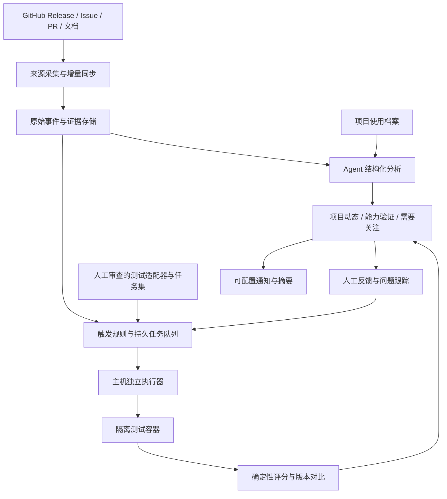

# 开源采集项目 Agent 监测与验证系统完整方案

文档版本：1.0  
编制日期：2026-10-16  
适用项目：github-trending / 开源观察  
文档性质：现状梳理、目标设计、实施路线与验收方案

> 本文中的“已实现”依据仓库代码说明和 2026-10-15 交付记录，不表示已重新检查 2026-10-16 的线上运行状态。“规划”与“建议”均不代表已经上线。源码检查、功能实测和 Agent 解读必须分别展示。

## 1. 建设目标

建立持续跟踪关注项目的系统，回答五个问题：

1. 哪些采集项目正在变热，变化趋势如何？
2. 哪个项目新增了功能，适用于什么场景和版本？
3. 哪个项目出现了问题，是否影响我实际使用的版本？
4. 新版本是否仍能完成我的固定采集任务，是否值得升级？
5. 已关注的问题是否真正修复，修复版本是否通过复测？

最终形成以下闭环：

**项目发现 → 关注与使用档案 → 来源监测 → 证据整理 → 影响分析 → 隔离验证 → 版本对比 → 提醒与人工反馈 → 修复复测。**

热度、项目能力、稳定性和 Agent 易用性分别评价。Star 数量不作为采集能力的替代指标，模型判断不作为运行测试的替代证据。

## 2. 用户与核心场景

| 使用者 | 主要需求 | 系统交付 |
|---|---|---|
| 项目选型者 | 找到适合具体采集任务的开源工具 | 热度趋势、能力覆盖、可比任务结果 |
| 已使用项目的开发者 | 及时发现升级风险和相关修复 | 与使用版本、场景相关的动态和测试结果 |
| 测评维护者 | 持续运行可复现的多项目测试 | 适配器、任务集、执行证据、失败归因 |
| 系统维护者 | 保证监测、执行器和数据可靠 | 心跳、同步延迟、队列、限流、备份与恢复状态 |

典型流程：用户关注一个项目，填写实际版本与依赖能力；系统发现新 Release，整理变化并执行适用测试；若旧版本通过而新版本失败，则在“需要关注”中展示任务回归及证据；待修复版本发布后，用同一任务重新验证。

## 3. 当前系统状态

### 3.1 已有能力与缺口

| 模块 | 已实现 | 尚需完善 |
|---|---|---|
| 项目发现与管理 | Trending、Star 总榜、采集项目观察、关注、笔记与采样 | 更完整的热度解释与分类比较 |
| 项目动态 | 公开 Release、Issue 增量观察、未读、状态历史、限流续传 | 更系统的 PR、文档差异和评论变化监测 |
| 使用档案 | 评估中/使用中、版本、场景、依赖能力 | 结构化版本范围、场景与测试任务映射 |
| Agent 分析 | 结构化摘要、影响、行动建议、证据引用、失效与失败状态 | 分类校准、冲突证据处理、反馈评估 |
| 自动测试触发 | 所有关注项目的正式 Release 入队，首次回填最近两个版本 | 无 Release 项目的可配置触发规则、修复事件触发 |
| 基础检查 | Python 3.12 语法、package.json 严格 JSON 检查 | 项目类别适配、超大归档处理 |
| 功能实测 | Scrapy 分页、去重、失败重试与字段检查 | 其他关注项目的专用功能适配器 |
| 执行管理 | 独立执行器、隔离容器、任务租约、重试、心跳、限流恢复 | 更完整的健康告警、日志保留策略 |
| 版本对比 | 同项目、同任务和可比环境下的结果比较、回归提示 | 偶发失败复核、性能统计、完整能力矩阵 |
| 问题追踪 | 保存原始事件、有限引用关联与分析证据 | Issue—PR—Release 的问题生命周期与自动复测 |
| 提醒 | 页面“需要关注”与测试回归展示 | 可配置外部通知、摘要、去重和静默策略 |

### 3.2 最近一次已记录验收

以下为 2026-10-15 的交付快照：

- 9 个关注项目，其中 6 个有已记录的正式 Release，3 个等待版本。
- 首轮 14 条自动任务：12 条通过，2 条执行错误；形成 6 组可比结果。
- 通过项包括 5 个项目的 10 条源码检查，以及 Scrapy 两版本的 2 条功能实测。
- `novel-plus` 两个版本的压缩归档超过 30 MiB 下载上限，未完成检查，未判为通过或回归。
- GitHub 公共 API 限流后按恢复时间自动续跑已验证。
- 98 项后端、22 项前端、21 项执行器测试通过。

详细依据：[自动检查交付记录](auto-validation-deployment-2026-10-15.md)。这些数字不等于当前线上实时状态，也不意味着其他项目已完成采集功能验证。

## 4. 设计原则与边界

1. **证据优先。** 每项功能、问题或修复结论都应能追溯到来源或执行记录。
2. **未知保持未知。** 未填写使用版本、缺少适配器、没有足够证据时，不推断实际影响或测试通过。
3. **分层评价。** 源码检查、功能测试、真实站点验证、Agent 使用体验分别报告。
4. **比较条件明确。** 跨项目只比较共同能力；同项目版本对比固定任务、数据和环境。
5. **确定性程序负责判分。** Agent 提取和解释信息，不自行决定执行是否成功。
6. **单个项目失败不阻塞其他项目。** 排队、限流、测试失败和基础设施错误使用不同状态。
7. **渐进建设。** 复用现有 FastAPI、Vue、PostgreSQL、Docker 和主机执行器，先补齐具体场景，再考虑扩大并发或引入新基础设施。

当前不做自动升级生产环境、自动合并上游代码或无限制执行仓库提供的命令。页面内容、Issue、README 和模型输出均不能直接转化为宿主机命令。

## 5. 目标架构



图中为目标架构。PR/文档全面监测、专用“能力与验证”页面、完整反馈闭环和外部通知仍属于规划。

### 5.1 模块职责

| 模块 | 责任 | 明确不承担 |
|---|---|---|
| 来源采集 | 增量同步、身份校验、分页、去重、保存原文和时间 | 推断所有 Issue 都是缺陷 |
| 分析服务 | 分类、提取能力声明、关联候选证据、生成建议 | 声称未执行过的任务已通过 |
| 规则与队列 | 选择任务、避免重复、记录租约和重试 | 执行模型生成的任意命令 |
| 主机执行器 | 获取固定版本、启动隔离任务、保存结果 | 接触生产采集凭据或修改业务数据 |
| 评分服务 | 校验输出、计算指标、判断可比性和退化 | 用主观文字代替机器证据 |
| 问题追踪 | 保存问题状态及状态迁移证据 | 将 Issue 关闭直接标为已修复 |
| 展示与通知 | 呈现事实、覆盖范围、待办和操作入口 | 把低置信度猜测作为确定警报 |

## 6. 监测与事件体系

### 6.1 三层监测

| 层次 | 来源或任务 | 输出 |
|---|---|---|
| 功能变化 | Release、更新日志、文档、已合并 PR | 新能力、配置变化、依赖变化、兼容性声明 |
| 问题变化 | Issue、维护者回复、关联 PR、修复版本 | 问题报告、确认状态、影响范围、修复进展 |
| 实际验证 | 固定任务、新能力任务、新旧版本对照 | 是否可复现、是否完成任务、是否发生退化 |

现有来源窗口应在界面保留可见说明：Release 每轮最近 30 条；Issue 首次回溯最近 30 天更新记录，每项目每轮最多 3 页、每页 100 条，未完成分页续传。有限引用采集不等于全面监测所有评论和 PR。

### 6.2 事件类型

规划统一以下业务类型：`feature`、`breaking_change`、`bug_report`、`fix`、`regression`、`maintenance`。现有分析接口的 `feature / breaking / bug / fix / other` 可通过映射渐进兼容，不直接破坏旧接口。

事件至少包含：项目 ID、上游对象 ID、来源类型、原文链接、来源时间、发现时间、变更时间、目标版本、原文摘要、分类、优先级、证据集合、验证状态和建议动作。

保存来源时间与发现时间两个维度。自动触发不能只比较上游发布时间，否则会漏掉较晚发现的发布或预发布转正式版本。

### 6.3 问题生命周期

```text
用户报告 → 维护者确认 → 本地复现 → 修复 PR 合并 → 修复版本发布 → 复测通过
```

这些状态是独立证据节点，不要求每个问题按顺序走完：可能未获维护者确认但已本地复现，也可能在复测后发现问题仍存在。

- Issue 关闭：仅表示来源关闭；另存关闭原因，不自动升级为修复。
- PR 合并：表示代码进入某个分支，不等于已发布。
- 修复发布：需明确版本和关联证据；不能仅凭标题相似确定。
- 复测通过：必须绑定具体版本、任务、环境和结果。
- 重开或复测失败：保留旧记录，新增状态变化，不覆盖历史事实。

关联优先使用明确引用、关闭关系或提交记录。Agent 给出的语义关联仅作为候选，需要证据规则或人工确认；不能把多个相似标题自动合并为同一个问题。

## 7. Agent 工作流程

### 7.1 从来源到建议

1. 获取尚未分析或证据已变化的事件快照。
2. 补充允许范围内的关联证据，记录遗漏、限流和截断情况。
3. 读取项目使用版本、场景和依赖能力；不发送无关私人笔记。
4. 提取发生了什么、适用条件、可能影响和待验证假设。
5. 返回结构化结果及已有证据 ID。
6. 校验字段、引用和版本上下文；无效输出保存失败状态。
7. 按已配置的规则选择测试适配器；缺失适配器时标为待配置。
8. 使用运行证据更新建议，并保留“作者声明”和“实测结论”的区别。

建议的目标输出示例（字段为方案设计，不是现有接口保证）：

```json
{
  "category": "feature",
  "summary": "发布说明声明新增断点续采能力",
  "impact": "当前使用版本未知，尚不能判断升级收益",
  "evidence_ids": ["release:123", "pull:456"],
  "verification": "pending",
  "recommended_suite": "resume-after-interruption-v1",
  "action": "执行中断恢复任务，核对漏采、重复和恢复位置"
}
```

`recommended_suite` 只能匹配管理员维护的已知任务，不能包含命令、动态脚本或任意下载地址。

### 7.2 两条独立测评轨道

| 轨道 | 固定条件 | 评价对象 |
|---|---|---|
| 项目能力测试 | 人工确认的适配器、任务、输入、环境 | 项目自身是否完成采集任务 |
| Agent 端到端测试 | 模型版本、提示词、工具权限、预算、初始环境 | Agent 安装、配置、使用项目的效果和成本 |

先完成项目能力测试。Agent 自动编写或修改适配器属于后续实验轨道，应在审查后才能进入正式基准；不能运行一次临时脚本就计入稳定能力覆盖。

## 8. 多项目测评方法

### 8.1 测评层级

| 层级 | 内容 | 可以得出的结论 | 不能得出的结论 |
|---|---|---|---|
| L0 基础检查 | 源码语法、清单格式 | 指定解释器下的受检文件可解析 | 项目可安装、能抓取或没有安全问题 |
| L1 固定功能任务 | 本地站点或固定响应样本 | 指定版本在固定场景下的行为 | 真实网站始终可用 |
| L2 授权真实场景 | 小规模真实接口/网页任务 | 指定时间与环境下的实际可用性 | 长期稳定或所有账号均适用 |
| L3 Agent 使用测试 | 安装、配置、运行、解释失败 | 特定 Agent 配置的使用体验 | 项目本身的纯粹能力排名 |

现状：关注项目自动接入 L0；Scrapy 已有 L1；其他项目的 L1、L2、L3 需分别建设。

### 8.2 任务集

| 场景 | 构造方法 | 核心断言 |
|---|---|---|
| 列表与详情 | 固定列表、详情及标准答案 | ID、字段及关联关系正确 |
| 分页 | 多页、空页、末页、重复页 | 不漏页、有终止条件 |
| 去重 | 跨页重复链接和重复记录 | 唯一键去重正确 |
| 失败重试 | 受控注入超时、429、5xx | 次数有界、等待合理、恢复后结果正确 |
| 动态页面 | 本地 JS 渲染或点击加载 | 等待正确、数据完整 |
| 增量同步 | 新增、更新、删除固定记录 | 增量语义与预期一致 |
| 中断恢复 | 在已知位置停止后重启 | 无漏采、不重复、恢复位置正确 |
| 字段鲁棒性 | 缺字段、不同布局、空值、Unicode | 缺失不编造、类型规范、解析稳定 |
| 访问边界 | 越界链接和测试权限 | 不访问未授权目标、不泄露凭据 |

上述测试并非所有项目都适用。不适用标为 N/A，缺少适配器标为未配置，未运行标为待执行，均不能记作通过。

### 8.3 适配器契约

每个适配器需要声明：

- 对应仓库数字 ID、支持版本范围、测试能力与不覆盖范围。
- 固定输入、允许访问的域名或本地服务、输出 Schema、唯一键。
- 构建方式、依赖版本、运行时、超时、内存和网络需求。
- 哪些行为来自项目自身，哪些属于测试辅助代码。
- 输出记录、请求/重试日志、退出状态及证据文件。
- 标准答案和评分规则，且执行 Agent 不应能修改评分结果。

约束：适配器不得用其他采集工具替代被测项目的核心功能；辅助归一化、启动本地站点和记录日志可以使用通用代码，但需明确披露。

### 8.4 下一批适配器候选

以下仅为待确认的任务设计，不是能力支持声明：

| 项目 | 首个候选任务 | 需用户确认 |
|---|---|---|
| Spider_XHS | 固定笔记列表/详情响应的解析、字段和分页处理 | 具体内容类型、必需字段及可提供样本 |
| TikTokDownloader | 固定元数据样本的解析和导出 | 目标记录类型、输出格式、是否需要媒体下载验证 |
| Douyin_TikTok_Download_API | 固定接口响应到输出 Schema 的映射 | 使用的具体接口及返回字段 |
| MediaCrawler | 选定平台的一条最小采集任务 | 平台、登录要求和允许使用的测试环境 |
| novel-plus | 先确定其项目类别、是否属于采集能力测评范围，再选择构建或功能任务 | 实际使用模块；源码过大不能直接当作质量差 |

固定响应解析通过只证明解析能力。若要声称“真实采集可用”，还需验证实际请求、认证、分页和响应处理路径。

## 9. 指标与结果判定

### 9.1 指标口径

| 指标 | 建议定义 |
|---|---|
| 任务成功率 | 满足全部必需断言的任务数 / 已有效执行的适用任务数 |
| 记录召回率 | 正确识别的预期唯一记录数 / 预期唯一记录总数 |
| 记录精确率 | 正确匹配的唯一记录数 / 输出唯一记录总数 |
| 字段准确率 | 正确字段值数 / 应核验字段值总数；缺失必需字段计错 |
| 重复率 | 超出唯一键首次出现的记录数 / 输出记录总数 |
| 恢复成功率 | 故障注入后仍满足数据断言的任务数 / 有效故障注入任务数 |
| 时延与成本 | 单任务耗时、请求数、CPU/内存、模型调用量及费用 |
| 测试覆盖率 | 已配置并有效执行的适用能力数 / 已声明需要评价的适用能力数 |

分母为零时显示不适用或无数据，不显示 100%。执行器故障、超限和安装失败单独计入“执行完成率”，不能通过将失败样本排除来制造整体高分。

### 9.2 新旧版本对比

比较前核对项目 ID、任务版本/指纹、固定数据、解释器与架构、资源限制及网络模式。性能对比还应固定硬件负载和运行次数。

| 基线结果 | 候选结果 | 解释 |
|---|---|---|
| 通过 | 通过 | 此固定任务未发现退化；不推广到全部能力 |
| 通过 | 断言失败 | 固定任务回归信号，应检查证据并复核 |
| 失败 | 通过 | 此固定任务改善；不自动宣称某 Issue 已修复 |
| 失败 | 失败 | 尚未通过，不能单凭结果判断变差 |
| 任意 | 执行错误/未覆盖/未运行 | 无法完成有效比较 |
| 不同任务或环境 | 任意 | 不可直接比较，说明差异 |

规划对不稳定任务增加复跑：建议至少 3 次并列出每次结果。确定性断言和有统计波动的性能指标分开处理；单次时延变化不产生性能退化结论。阈值在执行前确定，不看完结果再调整。

### 9.3 热度与选型展示

当前已有 Star 采样，可继续展示增长趋势；贡献者、发布频率等新增指标需要先补齐数据源。拟议热度排序应公开窗口、缺失数据和权重，不把采集延迟当作零增长。

推荐按同类项目、同任务比较，并同时展示覆盖范围和成本。第一阶段不制作跨所有项目的单一综合分数。

## 10. 自动触发、队列与恢复

### 10.1 触发规则

| 触发条件 | 当前状态 | 目标动作 |
|---|---|---|
| 关注项目首次出现正式 Release | 已实现 | 回填最近两个版本，建立基线 |
| 新发现正式 Release | 已实现 | 入队基础检查及已支持的功能任务 |
| GitHub 限流恢复 | 已实现 | 到恢复时间自动续跑，不消耗普通失败次数 |
| 适配器或测试数据更新 | 规划 | 重新验证基线和候选版本，避免跨任务指纹比较 |
| 关注问题发布修复版本 | 规划 | 触发对应问题的专用复测 |
| 定期稳定性检查 | 规划，可选 | 仅运行已授权的固定任务或真实场景 |
| 无 Release 的项目 | 当前等待 | 后续允许显式选择 tag/commit 规则，不能冒充正式发布 |

### 10.2 运行状态

```text
queued → running → passed / failed / unsupported
               ↘ error → 冷却或重试 → running
取消关注或隐藏 → cancelled
租约到期 → 重新领取或达到尝试上限后等待处理
```

现有队列持久化、唯一键和租约避免重复执行与过期结果覆盖；结果提交时再次核对关注状态。普通执行错误有重试上限，超过上限后保留人工重试入口。限流与正常断言失败必须分开。

规划优先级：使用中项目的明确回归、已关注问题的修复复测、新版本任务、历史回填。应为低优先级任务保留执行机会，避免长期饥饿。

## 11. 界面与提醒

### 11.1 页面结构

| 页面 | 主要内容 |
|---|---|
| 采集项目观察 | 发现项目、热度趋势、关注、使用档案与笔记 |
| 项目动态 | 按时间查看功能、问题、修复及原始来源 |
| 能力与验证（规划） | 能力矩阵、覆盖层级、版本、最近测试和证据 |
| 需要关注 | 相关变化、真实回归、执行异常、建议行动 |
| 运行状态（可先作为现有页面区块） | 数据新鲜度、队列、心跳、限流和失败原因 |

每个重要事项展示：发生了什么、影响谁、依据是什么、是否验证、建议动作。未知版本的影响必须显示待确认。

### 11.2 提醒规则

| 变化 | 提醒策略 |
|---|---|
| 关注能力正式发布 | 页面提示，明确作者声明还是已验证 |
| 使用版本出现可复现问题 | 高优先级，附复现条件、影响和已验证的临时方案 |
| 新版本导致固定任务失败 | 高优先级，附基线/候选版本与失败证据 |
| 已关注问题发布修复 | 提示修复声明并触发复测，复测后更新同一事项 |
| 普通讨论、重复报告 | 合并到动态或摘要，不逐条打扰 |
| 执行器离线、同步积压 | 运维提示，不能标成项目缺陷 |

外部邮件、即时通讯或 Webhook 仍为规划。实现前由用户选择渠道和接收人；只发送必要摘要和链接，不默认发送原始样本、凭据或私人笔记。按“项目＋问题/任务＋版本＋状态”去重，提供静默和摘要选项。

## 12. 数据模型与接口演进

### 12.1 现有主要实体

| 实体 | 现有表 | 用途 |
|---|---|---|
| 观察项目与热度 | `watch_projects`、`watch_samples` | 关注、项目信息、采样 |
| 动态与同步进度 | `monitor_events`、`monitor_states`、`monitor_runs` | 来源、历史、分页、同步状态 |
| 使用档案 | `project_profiles` | 版本、场景、能力 |
| 分析与运行 | `event_analyses`、`analysis_runs` | 结构化建议、证据、缓存和错误 |
| 自动验证 | `validation_jobs`、`validation_tracking`、`validation_worker_state` | 队列、触发基线、执行器联系时间 |
| 历史导入结果 | `validation_results` | 保留已有手动测试结果 |

### 12.2 规划补充

- 任务注册表：项目、能力、适配器版本、支持版本范围、数据指纹、环境与预算。
- 问题档案：统一问题 ID、来源关联、影响范围、各状态证据、关注状态。
- 复测关系：问题与任务、修复版本、运行记录的对应关系。
- 人工反馈：误报、漏报、建议是否有用、关联修正和理由。
- 通知投递记录：去重键、渠道、时间、结果、重试和静默设置。

优先复用现有表和 JSON 证据字段；只有需要独立查询、唯一约束或事务更新时才新增实体。迁移采用增量方式，保留既有笔记、关注状态和测试记录。

现有接口入口包括 `/api/watch/monitor`、`events`、`profiles/{id}`、`attention`、`analyze`、`validations` 和 `validation-jobs`。新增接口保持兼容；领取和提交执行任务继续通过主机侧受控管理流程，不把任意执行能力开放给浏览器。

## 13. 安全、预算与运维

### 13.1 执行隔离

- Web/API 不挂载 Docker socket；独立主机执行器管理测试容器。
- 校验公开仓库身份，解析具体提交并保存源码归档与任务指纹。
- 基础检查不导入、不执行项目源码，不提取归档到任意宿主路径。
- 测试容器采用非 root、只读根目录、去除 capabilities、资源限制及超时清理。
- 默认禁网。L2 真实站点任务需独立网络白名单和最小权限测试账号。
- 日志和报告不包含凭据；提示注入内容作为数据处理，不改变执行权限或评分规则。

### 13.2 当前预算与建议

| 项目 | 当前规则/说明 | 后续调整方式 |
|---|---|---|
| 动态检查 | 约每 6 小时；受限流和任务耗时影响 | 按重要性分级，先保证数据新鲜度可见 |
| 模型分析 | 每小时最多 5 个项目，每项目一条事件；已有结果轮换刷新 | 按积压与费用配置，不承诺实时覆盖所有事件 |
| 执行器 | 当前串行处理，空闲时每分钟检查 | 先测量资源，再考虑有限并发 |
| 源码归档 | 压缩 30 MiB、解压总量 100 MiB、最多 5000 条目、单个受检源码 2 MiB | 大项目选择专用适配，不全局无限放宽 |
| 测试成本 | 记录耗时、资源、请求和模型使用量 | 预算耗尽暂停并明确提示，不显示通过 |

不要为 `novel-plus` 简单取消所有资源上限。先确认要测的模块，选择固定子模块或在独立预算下运行专用构建任务；报告必须披露未覆盖的部分。

### 13.3 运维要求

现有部署服务器为 `192.168.1.23`，项目位于 `/Users/xai/Workspace/github-trending`。执行器是用户级 launchd 服务，需要用户登录且 Docker 可用；不能据此宣称已经具备无登录启动或高可用能力。

规划监控：同步延迟、待处理任务数、最长排队时间、执行器心跳、失败率、限流截止、磁盘占用、模型调用量。健康阈值根据已测运行时长制定，避免把长任务误判为离线。

升级前保存代码版本和数据库备份；升级后验证服务健康与关键数据。恢复时先停止执行器，恢复兼容代码，核对数据库迁移是否可逆，再处理失效租约，避免新旧执行器同时提交结果。

当前任务日志与归档不自动清理。建议后续实施可配置保留策略：结果与指纹长期保留，原始归档按容量和期限清理；删除前确认不存在运行中的任务，并保留必要审计信息。

## 14. 实施路线与验收

以下按交付成果划分，不预设完成日期。每阶段验收后再扩大项目覆盖。

| 阶段 | 优先级 | 主要交付 | 验收标准 |
|---|---|---|---|
| A：现状校验与档案完善 | P0 | 最新运行检查、重点项目清单、版本与场景 | 每个重点项目有明确使用状态；未知项明确标记；错误能说明原因 |
| B：首个非 Scrapy 功能适配器 | P0 | 固定样本、预期输出、适配器、评分、版本对比 | 至少两个版本可重复执行；故意注入漏采/重复/字段错误时能被检出 |
| C：扩展重点项目与能力矩阵 | P1 | 按业务优先顺序接入更多项目 | 每项能力明确层级、版本、时间和覆盖；未配置不冒充通过 |
| D：问题与修复闭环 | P1 | Issue—PR—Release 证据链、问题专用任务、修复复测 | 至少一个问题能追踪到修复版本和实测；关闭 Issue 不自动标记修复 |
| E：提醒与反馈 | P1 | 相关性规则、去重、摘要、人工反馈、可选外部渠道 | 相同事项不重复打扰；状态变化可追溯；通知失败有记录 |
| F：Agent 端到端与长期评估 | P2 | 固定模型/预算的实验轨道、成本与使用体验报告 | 与项目能力成绩分开；安装失败、工具替换和人工介入可见 |

### 14.1 必须验证的工程场景

- 重复同步同一个发布，不产生重复任务。
- 发布较早但较晚发现，仍能正确入队。
- 取消关注后停止新执行，过期租约不能覆盖新结果。
- 执行器退出、超时或网络失败后，状态可恢复且不伪造通过。
- GitHub 限流期间暂停相关请求，到恢复时间续跑。
- 不同任务指纹或环境不得产生确定的版本回归结论。
- 模型格式错误、引用不存在或输出被截断时，不保存为成功分析。
- 证据或档案变化后，旧分析不能继续作为最新结果展示。
- 基础检查不执行仓库脚本，敏感信息不进入报告。
- 升级与回滚不丢失既有项目、笔记、关注状态和结果。

### 14.2 业务效果评估

上线后先观察一个固定周期，记录发现延迟、误报、漏报、覆盖率和建议采纳情况。人工抽检应覆盖高优先级、普通动态、失败分析和未触发提醒的样本，不能只检查系统认为成功的结果。

“完整”不等于所有项目都测试所有能力，而是：**适用范围清楚、证据可追溯、执行可复现、失败可解释、修复可复测、遗漏可见。**

## 15. 用户需要提供的最小信息

下一轮建议先选择一个非 Scrapy 项目，填写以下表格。确实未知的项可留空，实施前再确认其对测试的影响。

| 项目 | 填写内容 |
|---|---|
| 仓库 | owner/repository |
| 使用状态与版本 | 使用中/评估中；实际版本或 commit |
| 最重要的采集任务 | 例如根据关键词采集笔记列表并读取详情 |
| 必需字段 | 例如 ID、标题、作者、发布时间、原文链接 |
| 唯一键与缺失规则 | 用什么去重；哪些字段允许为空 |
| 固定样本 | 可提供的 HTML/JSON、脱敏记录或本地测试站点 |
| 成功标准 | 记录数量、字段准确性、重复/漏采容忍度 |
| 真实场景需求 | 是否必须测试登录、下载、动态页面或增量更新 |
| 资源与权限 | 允许访问的环境、运行频率、时间与费用上限 |
| 提醒偏好 | 页面查看或另行配置通知渠道 |

凭据通过服务器配置或专门的密钥机制提供，不放入此文档、聊天正文或 Git 仓库。缺少真实网站权限时，先完成固定样本测试，并明确其不覆盖真实登录与在线采集。

## 16. 文档与实施资料

- [项目动态监测说明](project-monitor.md)：动态采集层的范围和接口；其中早期边界描述不涵盖后来新增的分析与测试模块。
- [项目分析与需要关注](attention-agent.md)：现有分析、证据和页面行为。
- [Scrapy 固定任务](scrapy-validation.md)：已有功能实测与历史导入。
- [自动执行器说明](auto-validation-worker.md)：任务执行、隔离、资源与重试规则。
- [自动检查部署验收记录](auto-validation-deployment-2026-10-15.md)：最近已记录的线上验证依据。
- [自动验证实施计划](superpowers/plans/2026-10-15-auto-validation.md)：已有工程改动与验收背景。

本文用于后续功能拆解与实施验收，不替代实时运行面板，也不宣称规划中的适配器、问题生命周期和外部通知已经实现。
